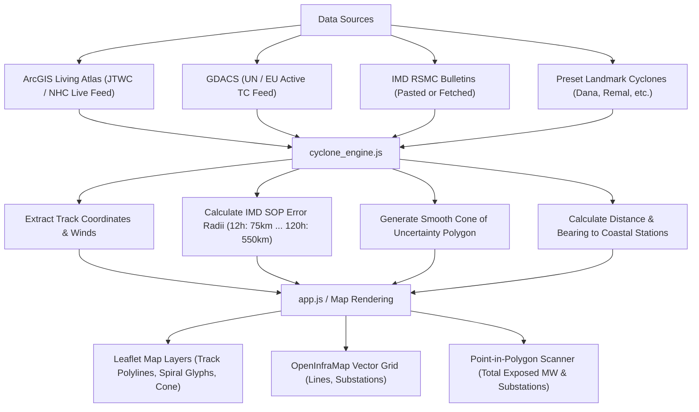

# 🌀 Live Cyclone Track & Power Grid Impact Dashboard

An interactive, real-time dynamic web application for tracking tropical cyclones across the North Indian Ocean (Bay of Bengal & Arabian Sea) and global basins, dynamically calculating the **IMD 70% Cone of Uncertainty**, and assessing spatial risks to electrical transmission lines, substations, and power plants on **OpenInfraMap** power layers.

---

## ⚡ Key Dynamic Features

1. **Live Cyclone Feeds & Auto-Refresh**:
   - **ArcGIS Living Atlas (JTWC / NHC)**: Continuously connects to authoritative live feeds of active tropical cyclones globally and across the North Indian Ocean.
   - **GDACS (UN / European Commission)**: Integrated disaster monitoring feed for tropical cyclones.
   - **Live Polling Indicator**: Visual pulsating badge indicating live connection status with configurable auto-polling intervals (1 min, 5 min, 15 min, or manual).

2. **Official IMD Cone of Uncertainty (COU) Generator**:
   - Programmatically constructs the expanding 70% probability cone of uncertainty from any forecast track coordinates using the official **India Meteorological Department (IMD) Standard Operating Procedure (SOP)** error radii:
     - **0 hr**: 30 km
     - **12 hr**: 75 km
     - **24 hr**: 150 km
     - **36 hr**: 200 km
     - **48 hr**: 250 km
     - **60 hr**: 300 km
     - **72 hr**: 350 km
     - **96 hr**: 450 km
     - **120 hr**: 550 km
   - Automatically handles tangent offsets, geodesic bearings, and circular end-caps.

3. **Smart IMD Bulletin Importer & Parser**:
   - Paste raw text from any official IMD advisory (RSMC New Delhi or Mausam portal).
   - Instantly extracts:
     - Cyclone Name & Classification (SuCS, ESCS, VSCS, SCS, CS, DD, D)
     - Issue time (UTC and IST)
     - Current Center Lat / Lon coordinates
     - Maximum sustained wind speeds (knots and km/h) & gusts
     - Forecast track positions
   - Computes distances & cardinal directions to nearest coastal radar stations and ports (Visakhapatnam, Kakinada, Machilipatnam, Bapatla, Gopalpur, Puri, Paradip, Dhamra, Sagar Island, Chennai).
   - Automatically re-renders the track and re-computes the cone of uncertainty in real-time.

4. **Power Grid Asset Impact Scanner**:
   - Evaluates vulnerable electrical transmission infrastructure located inside the dynamic cone polygon using ray-casting point-in-polygon spatial testing:
     - **High-Voltage Transmission Lines** (550+ kV, 310–549 kV, 220–309 kV, 132–219 kV) from live OpenInfraMap vector tiles.
     - **Substations** loaded dynamically from OpenInfraMap.
     - **Power Plants ≥100 MW** (from the WRI Global Power Plant Database) with fuel classification (Coal, Gas, Hydro, Solar, Wind, Nuclear) and cumulative exposed generation capacity (MW).
   - Click any exposed asset to fly directly to it on the map.
   - One-click **"Zoom to Cone"** to inspect the predicted landfall area.

5. **Interactive Track & Landfall Simulator**:
   - Manually edit track points, wind speeds, or add what-if forecast points.
   - Instantly observe how track alterations shift the cone of uncertainty and impact different transmission corridors.

6. **Pre-Loaded Landmark Benchmarks**:
   - **Cyclone Arnab** (October 2026 scenario — 85 kt VSCS heading toward Andhra Pradesh / Odisha)
   - **Cyclone Dana** (October 2024 — 60 kt SCS landfall near Dhamra, Odisha)
   - **Cyclone Remal** (May 2024 — 60 kt SCS landfall over West Bengal / Bangladesh Sundarbans)
   - **Cyclone Michaung** (December 2023 — 55 kt SCS along Tamil Nadu / Andhra Pradesh coast)
   - **Cyclone Biparjoy** (June 2023 — 75 kt VSCS over Arabian Sea into Gujarat)

---

## 🚀 Quick Start

### Option A: Open Directly in Your Browser (No Installation)
Simply double-click:
```bash
open index.html
# or
open arnab_cyclone_openinframap.html
```
The application will open in Chrome, Edge, Safari, or Firefox with full offline base-layer maps and interactive track plotting.

---

### Option B: Run with the Local Python Server (Recommended)
Running the included zero-dependency Python server provides an API proxy for CORS-free external data fetching and local network access:

```bash
python3 server.py
```
Then visit:
- **Main Dashboard**: [http://localhost:8000/index.html](http://localhost:8000/index.html)
- **Legacy URL**: [http://localhost:8000/arnab_cyclone_openinframap.html](http://localhost:8000/arnab_cyclone_openinframap.html)
- **Active Cyclones API**: [http://localhost:8000/api/active-cyclones](http://localhost:8000/api/active-cyclones)

---

## 📁 File Structure

```text
├── index.html                 # Main live dynamic cyclone tracking dashboard
├── arnab_cyclone_openinframap.html # Upgraded standalone entry point
├── app.css                    # Modern UI styles, dark/light theme, live badge, modals
├── app.js                     # Main frontend controller & reactive state manager
├── cyclone_engine.js          # Core meteorological math, IMD SOP cone & bulletin parser
├── cyclone_presets.js         # Historical and benchmark IMD cyclone tracks
├── base_data.js               # Natural Earth India coastlines, 41 cities & 379 power plants
├── leaflet-bundle.js          # Inlined Leaflet 1.9.4 & Leaflet.VectorGrid (offline ready)
├── leaflet.css                # Leaflet mapping styles
├── server.py                  # Python 3 standard library backend and proxy server
└── README.md                  # System documentation
```

---

## 🛰️ How Data is Processed



---

## 📋 Importing an Official IMD Bulletin

1. Visit [IMD RSMC New Delhi](https://rsmcnewdelhi.imd.gov.in/) or [IMD Mausam](https://mausam.imd.gov.in/).
2. Copy the text of the latest **National Cyclone Bulletin** or **Tropical Cyclone Advisory**.
3. In the dashboard top bar, click **"📋 Import IMD Bulletin"**.
4. Paste the text into the box and click **"Parse & Plot Dynamic Track"**.
5. The map will instantly center on the storm, generate the official cone of uncertainty, calculate distances to coastal ports, and highlight exposed substations and power plants!

---

## 🌐 Deploying to the Web

Because the entire client application is static with zero build steps or npm dependencies:
- **GitHub Pages**: Push this directory to a GitHub repository, go to `Settings > Pages`, and select the main branch.
- **Vercel / Netlify**: Drag-and-drop the folder into Vercel or Netlify for an instant live HTTPS deployment!

